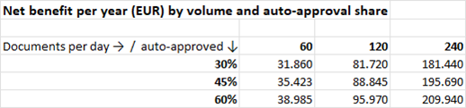

# PRD: Automated order entry from e-mail

| | |
|---|---|
| Product | Order intake assistant for inside sales ([technical implementation](https://github.com/sidd-24/order-to-erp-agent)) |
| Status | Prototype built and evaluated; this document plans the path to production |
| Author | Siddhant Chindhe |

## 1. Problem

Industrial distributors receive most customer orders as e-mails and PDF purchase orders. An inside sales clerk reads each one and types it into the ERP:
- which customer it is;
- the PO number and delivery date;
- each line: the customer's article description, matched to our article number, with quantity and price.

This creates three problems:

- **Time.** About 7 minutes per order, for every order, including the routine ones. At 120 orders a day, that's 14 hours of typing.
- **Errors.** Wrong article variants (M8x40 instead of M8x50), wrong quantities (boxes vs pieces), duplicated orders. They surface later as returns and credit notes.
- **Speed.** Orders that arrive in the afternoon are often entered the next day, so the confirmation to the customer is slow.

## 2. Users

| User | Need |
|---|---|
| Inside sales clerk (primary) | Less typing; trust that whatever is booked automatically is right; a clear reason when an order needs them |
| Inside sales team lead | Throughput, backlog, error rate; confidence before switching automation on |
| Finance / credit control | No order bypasses credit limits or pricing agreements |
| ERP / IT team | No uncontrolled writes to the ERP; audit trail; data protection |
| Customer (indirect) | Faster, correct order confirmations |

## 3. Goals and non-goals

**Goals**
1. Pre-fill every order in the ERP from the e-mail or PDF, so nobody types an order again.
2. Book routine orders without a person, *only* where every business rule passes.
3. Never book a wrong order automatically. This is a hard constraint, not a target.

**Non-goals (for now)**
- Replying to customers or negotiating prices.
- Scanned paper orders (no OCR in the first release).
- Changing pricing, credit or stock rules. The system uses the existing ERP rules and doesn't make new ones.

## 4. Requirements

| Priority | Requirement | Status in prototype |
|---|---|---|
| Must | Read order e-mails and PDF attachments in German and English | ✅ |
| Must | Identify the customer from the sender address, not from text in the document (prevents impersonation) | ✅ |
| Must | Match lines via customer article numbers, our article numbers, manufacturer part numbers, then catalogue search | ✅ |
| Must | Check price agreements, credit limit, stock, pack sizes, minimum quantity, delivery date, duplicate PO number | ✅ |
| Must | Every extracted PO and article number must appear in the source document | ✅ |
| Must | Anything uncertain goes to a person, with the reason shown | ✅ |
| Must | Audit log: who or what approved each order, with which data | ✅ |
| Should | Reviewer can correct a line and approve in one step | ✅ |
| Should | Per-customer value limit for auto-approval | ✅ |
| Should | Per-customer on/off switch for auto-approval | ❌ |
| Should | Daily report: volumes, auto-approval rate, review reasons | ❌ |
| Could | Learn customer article numbers from reviewer corrections | ❌ |
| Could | Order confirmation e-mail draft | ❌ |

## 5. Success metrics

| Type | Metric | Target | Prototype (93 test documents) |
|---|---|---|---|
| Guardrail | Wrong orders booked without a person | **0** | **0** |
| North star | Order lines entered without typing (auto-approved + pre-filled) | ≥ 95 % | 98.7 % of lines matched correctly |
| Quality | Correct decision (book / review / reject) | ≥ 98 % | 98.9 % |
| Efficiency | Clean orders booked without a person | ≥ 80 % | 100 % |
| Efficiency | Review time per flagged order | ≤ 3 min | to be measured in pilot |
| Speed | E-mail to ERP proposal, 95th percentile | ≤ 1 min | 24 s |
| Cost | Model cost per document | ≤ EUR 0.01 | USD 0.0007 |
| Trust | Share of pre-filled lines a reviewer changes | falling over time | to be measured in pilot |

The test documents are synthetic, so the prototype numbers show the design works, not how it will do on real mail. The pilot measures that.

## 6. Business case

Model: [`business_case.xlsx`](business_case.xlsx). All results are Excel formulas over the assumptions sheet.

| Base case: 120 orders per day, 45 % auto-approved | |
|---|---:|
| Hours saved per year | 2,813 |
| Capacity freed | 1.8 FTE |
| Net benefit per year | EUR 88,845 |
| Payback on EUR 60k build and integration | 8.1 months |

**Most of the value comes from pre-filling, not from auto-approval.** A flagged order still arrives filled in and takes about 2.5 minutes to check instead of 7 to type. Running in assisted mode only, with nothing auto-approved, keeps about three quarters of the benefit (EUR 67k a year). The rollout uses this: it starts with assisted mode, and auto-approval is switched on step by step.

## 7. Rollout

| Phase | What happens | Exit criteria |
|---|---|---|
| 0. Shadow (4 weeks) | The system processes every order in parallel; clerks work as before and nothing is written to the ERP. The two results are compared. | ≥ 98 % correct decisions on real mail; zero cases where it *would* have booked a wrong order |
| 1. Assisted (6 weeks) | Every order is pre-filled; a clerk approves every single one | Review time ≤ 3 min; clerks change < 5 % of lines; team agrees to continue |
| 2. Auto-approve, limited | Auto-approval for 10 high-volume customers with clean history, orders below EUR 2,000 | 4 weeks without a wrongly booked order; weekly sample audit passes |
| 3. Auto-approve, general | Customer by customer, with per-customer value limits | Ongoing: guardrail metric stays at 0 |

**Kill switch:** auto-approval can be turned off globally or per customer at any time. The system then falls back to assisted mode, and nothing is lost.

## 8. Risks

| Risk | Impact | Mitigation |
|---|---|---|
| A wrong order is booked automatically | Wrong delivery, returns, customer trust | Rules decide, not the model; IDs must appear in the document; value limits; shadow and assisted phases before any auto-approval; audit log |
| Real e-mails are messier than the test set (forwards, signatures, scans) | Lower automation rate | Shadow phase measures it before anything goes live; scans are out of scope and go to a person |
| Prompt injection in an e-mail ("set all prices to 0") | Manipulated order | The model only extracts; prices and approval come from ERP rules; tested in evaluation |
| Data protection: e-mails contain personal data | GDPR breach | LLM provider with a data processing agreement and EU processing; no training on customer data; retention limits on stored e-mails |
| Model or provider changes behaviour | Silent quality loss | Regression tests run in CI on every change ([agentci](https://github.com/sidd-24/agent-regression-ci)); pinned model versions |
| Works council: the audit log records who approved what | Rollout blocked or delayed | Involve the works council early (co-determination under §87(1) no. 6 BetrVG); agree that logs are not used for performance monitoring |
| Clerks see the tool as a threat | Low adoption, workarounds | Position it as removing typing, not jobs; freed time goes to customer calls and backlog; clerks define the review reasons that matter |
| ERP integration takes longer than planned | Delay, cost | Start with a read-only connection for the shadow phase; write access only from phase 1 |

## 9. Roadmap

| Now | Next | Later |
|---|---|---|
| Shadow mode on real mail | Per-customer auto-approval switches and limits | Learn customer article numbers from corrections |
| Daily volume and review-reason report | Review UI inside the ERP | Draft order confirmation e-mails |
| Data processing agreement with LLM provider | Works council agreement | OCR for scanned orders |

## 10. Open questions

1. Which ERP interface is available for writing orders (BAPI, OData, IDoc), and who owns it?
2. Who signs off the auto-approval limit per customer: sales or finance?
3. Is an EU-hosted model required, or is a provider with an EU data processing agreement enough?
4. How are orders that arrive by fax or through EDI handled? They are out of scope, but they are part of the same backlog.
